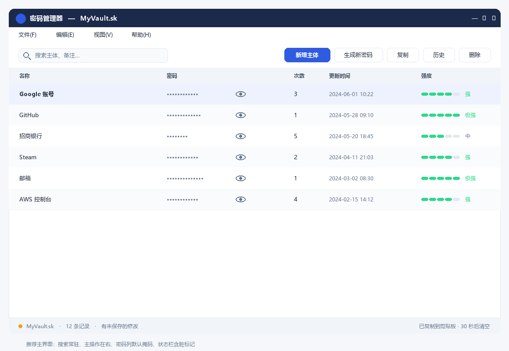
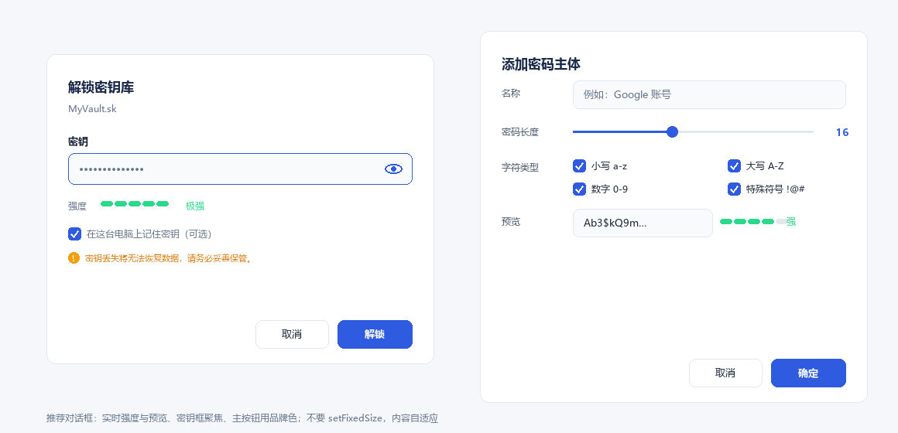

# 密码管理器 Password Manager

**本地优先**的密码管理工具：**密码不以明文落盘** —— 由「主体名 + 盐 + 算法版本」确定性生成，
整个库以 **AES-256-GCM** 加密保存为单个 \.sk\ 文件；支持 Windows 桌面端与 Android 端
**通过局域网直连互通**，不依赖任何云服务器。

[](https://github.com/xiesat/password-manager/actions/workflows/ci.yml)


> ⚠️ 本项目为个人/学习向工具，**未经专业安全审计**。请勿将其作为关键凭据的唯一副本。

## 截图





---

## 目录

- [这是什么](#这是什么)
- [特性](#特性)
- [安全设计](#安全设计)
- [多端同步](#多端同步)
- [安装](#安装)
- [使用指南](#使用指南)
- [项目结构](#项目结构)
- [规范与测试向量](#规范与测试向量)
- [开发](#开发)
- [常见问题](#常见问题)
- [版本与路线图](#版本与路线图)
- [许可](#许可)

---

## 这是什么

它解决的是一个具体问题：**密码库文件本身泄露时，不暴露任何密码。**

- 密码不是"随便生成一串然后存起来"，而是由 **主体名 + 随机盐 + 算法版本** 通过
  PBKDF2 密钥流 + 拒绝采样**确定性推导**出来。规则（不含密码）随记录保存，
  所以「重新生成」与「历史密码」都能被精确复现。
- 密码随整个库一起被 AEAD 加密后再落盘。单独的 \.sk\ 文件被拿走，在没有密钥的情况下
  既拿不到密码，也无法篡改（GCM tag 覆盖文件头、盐、nonce 与密文）。
- 两端（桌面 / Android）共用**同一份文件格式与合并算法**，各有一套独立实现，
  并用**跨语言黄金测试向量**把两者钉死在一起。

适用场景：个人自用、希望密码库**离线保存**、需要手机与电脑之间互通但不想架服务器。

---

## 特性

### 桌面端（Windows / Python + PySide6）

| 分类 | 说明 |
|---|---|
| 加密 | AES-256-GCM（AEAD），PBKDF2-HMAC-SHA256 600,000 次迭代，随机 16 字节盐，参数写入文件头可平滑升级 |
| 存储 | 单文件 `v3:<base64(header\|salt\|nonce\|tag\|ciphertext)>`；**原子写入**（临时文件 + fsync + 替换） |
| 兼容 | 旧格式 **v1 / v2 只读兼容**，打开后自动升级为 v3 |
| 生成 | 算法 v2：PBKDF2 密钥流 + 拒绝采样，无 60-bit 熵上限；长度 4–128，四类字符可选 |
| 界面 | QTableView + 排序/过滤代理、**实时搜索**、多选批量复制/删除、拖拽排序 |
| 隐私 | 密码列默认掩码、剪贴板 **30 秒后自动清空** |
| 数据 | **CSV 导入 / 导出**、撤销/重做、历史密码（按规则还原，可逐条复制） |
| 外观 | 浅色 / 深色 / 跟随系统主题，中英双语界面 |
| 运维 | 自动备份（同目录 `.password_manager_backups/`，保留最近 10 份）；配置与日志写入 `%APPDATA%\PasswordManager\` |
| 同步 | 内置局域网同步（主机 + 客户端），配对二维码，进度条与明确结果提示 |

### Android 端（Kotlin + Jetpack Compose）

| 分类 | 说明 |
|---|---|
| 核心 | `android/core` 是纯 Kotlin/JVM 库：加密容器、schema 4、三方合并、HLC、同步协议、确定性生成器 |
| 功能 | 创建/解锁密码库、新增主体并生成密码、**重新生成**、**查看历史密码**、显示/隐藏、复制、删除、锁定 |
| 同步 | **首次从桌面端导入**整库，之后双向合并（冲突两个版本都保留） |
| 体验 | 耗时操作显示**全屏进度遮罩**，历史密码**逐条还原并显示进度**；配对信息记忆，不必每次扫码 |
| 兼容 | minSdk 26（Android 8.0+），targetSdk 35，自适应图标与桌面端同款 |

### 性能（Android 关键优化）

密码库的每一次读写都涉及 PBKDF2，这在手机上是主要瓶颈。已做的优化：

| 优化 | 效果（本机 x86 实测，手机约为其 3–5 倍耗时） |
|---|---|
| PBKDF2 复用单个 `Mac` 实例（不再每轮迭代新建） | 20 万次 **96ms → 40ms**，60 万次 **291ms → 120ms**（**2.4×**，已与平台原生实现持平） |
| 会话内复用 `VaultKey`（密钥 + 盐 + 迭代数），保存只做 AES-GCM | 一次保存 **122ms → <1ms** |
| 历史密码缓存（按库版本失效） | 重开同一条记录**秒开** |

> 每次加密仍生成**新的随机 nonce** —— GCM 下同一密钥重复使用 nonce 是致命的，
> 这一点由跨语言夹具与测试专门锁定。

---

## 安全设计

| 项目 | 说明 |
|---|---|
| 加密 | AES-256-GCM |
| 密钥派生 | PBKDF2-HMAC-SHA256，600,000 次，随机 16 字节盐 |
| 随机数 | Python `secrets` / `os.urandom`；Android `SecureRandom` |
| 完整性 | GCM tag 覆盖 magic、版本、迭代数、盐、nonce 与密文（AAD） |
| 密码生成 | PBKDF2 密钥流 + 拒绝采样（算法 v2） |
| 落盘内容 | `v3:<base64(magic\|version\|iterations\|salt\|nonce\|tag\|ciphertext)>` |
| 密码形态 | 运行期在内存中为明文；落盘时随整库一起被 AEAD 加密 |
| 明文落盘 | 无 |

**威胁模型边界**：本工具防御「密码库文件泄露」与「文件被篡改」。
它**无法**防御已被攻陷的操作系统、键盘记录器、内存取证、或解锁期间的屏幕窥视。

局域网同步的安全性来自：

- 交换的是**整库密文**，链路本身用明文 HTTP 也不泄露内容；
- 认证密钥 `HKDF-SHA256(token, salt=vault_id, info="pm-sync-auth-v1")`，
  每个请求用 `HMAC-SHA256` 对「时间戳 + nonce + 方法 + 路径 + 正文哈希」签名；
- 响应同样被签名，客户端会校验；
- 时间戳窗口 ±300 秒 + **跨窗口共享的 nonce 去重**抵御重放；
- 配对令牌在**一次程序运行内保持不变**（重启程序轮换），因此关闭同步窗口不会让
  已经发出去的配对信息失效。

细节见 [spec/SYNC_PROTOCOL.md](spec/SYNC_PROTOCOL.md)。

---

## 多端同步

目标：桌面端 + Android 端，**不依赖云服务器**，局域网直连。当前状态：**两端均已实现并通过测试**。

### 首次加入（bootstrap）

新设备上还没有库时**不能走合并** —— 空库会被三方合并判成"对端删除了所有记录"。正确流程是：

1. 桌面端打开库 → 菜单「**同步 → 局域网同步…**」显示配对二维码；
2. 手机点「**同步**」→ 扫描二维码（或粘贴配对信息）→ 输入**桌面端那个库的密钥** → 点「**从桌面端导入**」；
3. 手机通过 `GET /vault` 下载整库密文，解密后保存为本机库。

导入完成后两端即为**同一个库**，此后各自修改再点「同步」做双向合并。

### 日常同步的冲突处理

| 情形 | 结果 |
|---|---|
| 两端修改了**不同的**记录 | 自动合并 |
| 同一条记录被两端**都改动** | **保留两个版本**并标记冲突，绝不静默丢弃 |
| 一端删除、另一端修改 | 保留存活版本 |
| 两端都删除 | 收敛为一条墓碑 |

- **确定性收敛**：冲突副本 ID 由 `uuid5(namespace, "<vault_id>:<id>:<hlc>:<semantic_hash>")` 派生，
  两端独立计算得到完全相同的结果。
- **排序**：混合逻辑时钟（HLC），字符串比较即时间顺序，`observe()` 吸收对端时钟。
- **列表显示顺序**不参与同步（仅本机偏好）。

---

## 安装

### 方式一：Windows 免安装 exe（推荐给最终用户）

到 [Releases](https://github.com/xiesat/password-manager/releases) 下载最新的
`PasswordManager.exe`，双击即可，无需 Python。

> exe 未做代码签名，Windows SmartScreen 可能提示风险，请自行决定是否信任。

### 方式二：从源码运行（开发 / 想要最新代码）

需要 Python 3.10 – 3.14（PySide6 提供 `cp310-abi3` wheel，已在 **Python 3.14.8** 上验证）。

```bash
git clone https://github.com/xiesat/password-manager.git
cd password-manager
python -m venv .venv
.venv\Scripts\activate            # Windows；Linux/macOS 用 source .venv/bin/activate
pip install -r requirements.txt
python main.py
```

也可以直接双击 `run.bat`（Windows，内部就是调用 venv 里的 python 执行 `main.py`）。

打包为单文件 exe：

```bash
pip install pyinstaller
pyinstaller 密码管理器.spec
# 产物：dist/PasswordManager.exe
```

### 方式三：Android

每个 Release 都附带 CI 构建好的 **`PasswordManager-android-debug.apk`**（debug 签名，可直接安装），
手机浏览器打开 Release 页面下载安装即可（需允许「安装未知应用」）。

自行构建（仓库已包含 Gradle wrapper，需要 JDK 17+ 与 Android SDK）：

```bash
cd android
./gradlew :app:assembleDebug        # Windows: gradlew.bat :app:assembleDebug
```

产物：`android/app/build/outputs/apk/debug/app-debug.apk`。也可以用 Android Studio 直接打开 `android/`。

---

## 使用指南

### 桌面端

1. **新建文件**：选择库文件位置（`.sk`）→ 输入密钥两次。此密钥用于加密整个库，**丢失不可恢复**。
2. **打开文件**：选择 `.sk` → 输入密钥解锁。若是 v1/v2 旧文件，会提示升级为 v3。
3. **新增主体**：填名称与密码规则，立即生成密码；该密码同时进入历史。
4. 右键或工具栏可**生成新密码 / 复制 / 历史 / 删除**；`Ctrl+S` 保存。

### 快捷键

| 快捷键 | 动作 |
|---|---|
| `Ctrl+N` / `Ctrl+O` | 新建 / 打开 |
| `Ctrl+S` / `Ctrl+Shift+S` | 保存 / 另存为 |
| `Ctrl+Z` / `Ctrl+Y` | 撤销 / 重做 |
| `Ctrl+C` / `Delete` | 复制密码 / 删除选中 |
| `Ctrl+F` / `Ctrl+L` | 搜索 / 锁定 |
| `Ctrl+Shift+Y` | 局域网同步 |
| `Ctrl+Q` | 退出 |

### Android 端

1. 创建密码库（自设密钥）或按上面的「首次加入」从桌面端导入；
2. 点任意一行打开**条目详情**：复制 / **重新生成** / **查看历史密码** / 删除；
3. 顶部「同步」发起局域网同步，对话框内会显示进度与结果。

---

## 项目结构

```
.
├─ main.py                    #  32 行  入口：日志、翻译、启动
├─ controller.py              # 617 行  流程编排：文件、剪贴板、备份、同步、自动加载
├─ model.py                   # 598 行  数据与加密编排（不依赖 Qt）
├─ view.py                    # 739 行  PySide6 界面（不含业务逻辑）
├─ encryption.py              # 164 行  VaultCipher(AES-256-GCM) + v1/v2 兼容解密
├─ password_generator.py      # 194 行  v2 安全生成器（+ v1 兼容复现 + 强度评估）
├─ merge.py                   # 192 行  三方合并引擎（多端冲突保留）
├─ sync_service.py            # 476 行  局域网同步服务（主机 + 客户端、HMAC 认证）
├─ sync_dialog.py             # 176 行  同步界面（二维码配对、进度与结果）
├─ hlc.py                     #  53 行  混合逻辑时钟
├─ table_model.py             # 163 行  QAbstractTableModel + 过滤/排序代理
├─ theme.py                   #  95 行  浅色/深色调色板与 QSS 生成
├─ io_exchange.py             #  86 行  CSV 导入导出
├─ storage.py                 #  69 行  原子写入、%APPDATA% 配置
├─ applog.py                  #  23 行  滚动日志
├─ spec/                      # 跨平台格式/协议规范 + 黄金测试向量 + 跨语言夹具
├─ android/                   # Android 客户端（Kotlin/Compose）
│  ├─ core/                   #   纯 Kotlin/JVM：加密、格式、合并、HLC、协议、生成器
│  ├─ app/                    #   Compose 界面 + 仓库 + ViewModel
│  ├─ tools/make_icons.py     #   由 resources/app_icon.png 生成启动图标
│  └─ verify-core.{sh,ps1}    #   无需 Android SDK 即可校验 core
├─ resources/                 # 图标、QSS 模板、中英翻译
├─ tests/                     # 14 个 pytest 测试文件
└─ docs/                      # 界面效果图
```

---

## 规范与测试向量

两端是**独立实现**，靠规范 + 黄金向量保证一致：

| 文件 | 内容 |
|---|---|
| [spec/VAULT_FORMAT.md](spec/VAULT_FORMAT.md) | 加密容器与 schema 4 载荷格式 |
| [spec/SYNC_PROTOCOL.md](spec/SYNC_PROTOCOL.md) | 局域网同步协议（认证、端点、首次加入） |
| [spec/merge_vectors.json](spec/merge_vectors.json) | 哈希/规范化/三方合并黄金向量 |
| [spec/generator_vectors.json](spec/generator_vectors.json) | 密码生成、规则解析与**规则构建**向量 |
| [spec/sync_vectors.json](spec/sync_vectors.json) | HKDF 派生密钥与 HMAC 签名向量 |
| [spec/fixtures/](spec/fixtures) | 跨语言加解密夹具（Python 生成 → Kotlin 解密，反之亦然） |

其中 `spec/fixtures/reused_key.*` 专门锁定「会话内复用盐保存」这条路径：
两次保存必须**盐相同、nonce 不同**，且桌面端能正常打开。

---

## 开发

```bash
pip install -e ".[dev]"          # 或：pip install pytest ruff mypy
ruff check . && ruff format --check . && mypy
set QT_QPA_PLATFORM=offscreen && pytest -q     # Windows
```

当前质量门（全部通过）：

| 项目 | 结果 |
|---|---|
| Python 测试 | **178** 项（加解密往返与篡改检测、v1/v2 兼容、生成器、规则、模型往返、撤销、CSV、主题、i18n、HLC、合并、同步、离屏 UI 冒烟、Kotlin 夹具） |
| Kotlin 跨语言检查 | **139** 项（无需 Android SDK） |
| ruff check / ruff format --check | 通过（30 个 Python 文件） |
| mypy | 通过 |
| CI | 6 个 job：Python 3.11 / 3.12 / 3.13 / 3.14 + `kotlin-core` + `android-app` |

校验 Kotlin core（不需要 Android SDK，只需 JDK）：

```bash
bash android/verify-core.sh                            # Linux / macOS / Git Bash
powershell -ExecutionPolicy Bypass -File android\verify-core.ps1   # Windows
```

输出形如：

```
checks=139 failures=0
ALL KOTLIN CORE CHECKS PASSED
```

---

## 常见问题

**Q：同步时报「配对令牌不正确（签名校验失败）」？**
配对信息必须来自**当前正在运行**的桌面端同步窗口。令牌在一次程序运行内保持不变，
但**重启桌面程序会轮换令牌**。请重新扫码。

**Q：同步时报「本机与对端时间相差约 N 秒」？**
两台设备的系统时间相差超过 5 分钟。请校准时间（一般打开手机的"自动设置时间"即可）。

**Q：首次同步时桌面端弹出防火墙提示？**
请选择「专用网络」并允许，否则手机连不上。

**Q：为什么同步走 HTTP 而不是 HTTPS？**
交换的是**整库密文**，内容不依赖 TLS 保护；认证由配对令牌 + HMAC 提供。
这样可以避免两端处理证书，尤其是在 Android 上。

**Q：忘记库密钥怎么办？**
无法恢复。密码与数据都由该密钥派生/加密，设计上不存在后门。

**Q：手机能当主机吗？**
目前手机**只做客户端**（桌面端是主机）。手机当主机需要内置一个 HTTP 服务，属于后续工作。

---

## 版本与路线图

当前版本 **v0.11.1**。Release 同时提供 Windows exe 与 Android APK。

- [x] 阶段 0：止血（原子写入、配置迁移、日志、清理死代码）
- [x] 阶段 1：安全加固（AES-GCM v3、安全生成器、去除硬编码密钥、兼容旧格式）
- [x] 阶段 2：修复已知缺陷（另存为、撤销上限、备份时间戳、历史窗口）
- [x] UI 升级：集中主题、掩码、实时搜索、解锁对话框、脏标记
- [x] 阶段 3：工程化（pyproject、pytest、ruff、mypy、CI、自动发布）
- [x] 阶段 4：开源文件（README / LICENSE / CHANGELOG / SECURITY / CONTRIBUTING）
- [x] 阶段 5（v0.3.0）：QTableView/Model/Proxy、CSV 导入导出、深色主题、中英双语
- [x] **多端同步 P1–P2**：schema 4 格式 + 三方合并引擎 + 黄金向量
- [x] **多端同步 P3–P4**：局域网传输（二维码配对、HMAC 认证、防重放）
- [x] **多端同步 P5**：Android 客户端（Kotlin core 与 Python 逐字节对齐 + Compose 界面）
- [x] **首次加入**：`GET /vault` 整库下载，新设备一键加入
- [x] **体验与性能**：同步进度与结果提示、历史密码进度与缓存、PBKDF2 提速 2.4×、会话内复用密钥
- [ ] 后续：Android 端搜索 / 主题、手机作为同步主机、增量同步、代码签名证书

详细计划见 [IMPROVEMENT_PLAN.md](IMPROVEMENT_PLAN.md)，变更史见 [CHANGELOG.md](CHANGELOG.md)。

---

## 许可

本项目以 **MIT** 许可发布，见 [LICENSE](LICENSE)。

运行时依赖 [PySide6](https://www.qt.io/qt-for-python)（**LGPLv3**）与
[PyCryptodome](https://www.pycryptodome.org/)（Public Domain / BSD）。
以二进制形式分发时，请同时遵守 PySide6 的 LGPL 条款（附许可证文本，
并提供替换/重新链接 Qt 的方式）。若不想处理这些义务，可将本项目整体改用 **GPLv3**。

---

## English summary

A local-first password manager: **no password is ever stored in plaintext**. Passwords are
derived deterministically from *(subject name + salt + algorithm version)*, and the whole vault
is encrypted as a single **AES-256-GCM** file (PBKDF2-HMAC-SHA256, 600k iterations, parameters in
the file header). Legacy v1/v2 vaults stay readable and are upgraded to v3 on open.

- **Desktop**: Python + PySide6 (prebuilt Windows exe available), CSV import/export, undo/redo,
  password history, dark theme, EN/ZH UI, atomic writes, rolling backups, clipboard auto-clear.
- **Android**: Kotlin + Jetpack Compose. The `core` module is a pure JVM library that is
  **byte-for-byte compatible** with the Python reference, verified by **139 cross-language checks**
  that need no Android SDK.
- **LAN sync**: no cloud. The desktop hosts an HTTP endpoint and shows a pairing QR code; a new
  device downloads the whole vault via `GET /vault`, then both sides three-way merge.
  **Conflicts keep both versions** and converge deterministically via `uuid5` conflict IDs and a
  hybrid logical clock. Authentication uses HKDF + HMAC with a timestamp window and nonce dedupe.
- **Tests**: 178 Python tests, 139 Kotlin checks, ruff + mypy clean, 6 CI jobs.

Licensed MIT; PySide6 is LGPLv3.
